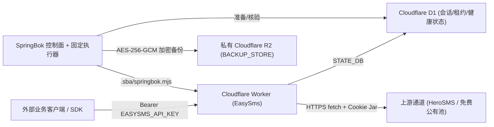

# Architecture

`EasySms` 采用纯 **Cloudflare Workers** 单体对外 HTTP 服务架构，配合 **Cloudflare D1** 持久化状态与 **私有 Cloudflare R2** 加密备份存储，通过 `.sba/` 接入 **SpringBok** 统一控制面。

## 分层边界

1. **Web 接入与路由层（`service/base/src/worker/index.ts`、`src/http/web-router.ts`）**：
   - 处理标准 Web `Request`/`Response` 与定时 `scheduled` 事件。
   - 强制校验 `EASYSMS_API_KEY`（仅 `/healthz`、`/openapi.json`、`/.well-known/easysms-release.json` 匿名开放）。
   - 在 `SBA_PURPOSE=preview` 下强制隔离付费激活与外部主动探测副作用。
2. **领域与编排层（`EasySmsService` + `EasySmsProviderOperationalState`）**：
   - 管理会话计划、号码复用租约、OTP 基线去重、失败冷却、探测趋势惩罚与 `keepRecentCount` 历史状态裁剪。
3. **存储层（`service/base/src/persistence/d1-store.ts`）**：
   - 基于 Cloudflare D1 `easysms_runtime_state` 表维护带单调 `revision` 与 `SHA-256` 完整性摘要的状态快照。
4. **SpringBok SBA 适配层（`.sba/`）**：
   - 实现 `deploy`、`update`、`verify`、`preview`、`destroy-preview` 五个生命周期动作。
